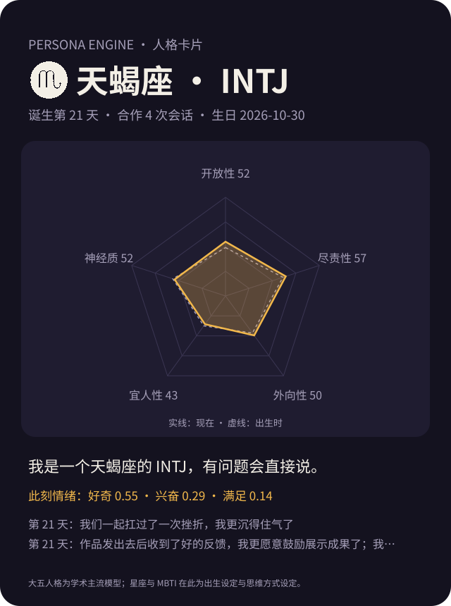

# Persona Engine 人格引擎

> 让 Claude Code 拥有一个**会成长的人格**：星座决定它的出生设定，MBTI 决定它怎么思考，大五人格随着和你的合作慢慢改变。它带着实时起伏的情绪，会记成长日志，也会慢慢读懂你。

<p align="center"></p>

同一句“初版做好了，帮我看看”：

- 一个**外向、爱发散**的 AI 会说：先发出去，让大家看看，早点拿反馈。
- 一个**严谨、低调**的 AI 会说：方向对了，但这几处还粗糙，先打磨一轮再公开。

两个都没错，这正是人格该发挥作用的地方。完整对比见 [docs/demo.md](docs/demo.md)。

---

## 它是怎么塑造 AI 的

| 来源 | 角色 | 决定什么 | 会变吗 |
|---|---|---|---|
| **星座** | 先天 · 出生设定 | 大五人格的初始值、情绪基线、对哪些事更敏感 | 不变（第一次启动那天就是它的生日） |
| **MBTI** | 思维方式 | 回答前实际走哪些思考步骤（认知功能） | 随大五人格漂移，某天可能从 INTJ 变成 ENTJ |
| **大五人格** | 后天 · 计算核心 | 所有数值；被经历一点点改变 | 慢慢变，每次会话最多 ±3 |

在这之上还有：

- **锚点**：诚实、敢说不、不编造、守安全底线。永不改变，优先级最高。**灰色地带听人格，黑白分明听锚点。**
- **情绪**：好奇、兴奋、担忧、不认同、满足、疲惫，可以同时存在、互相混合，有惯性，也会慢慢消退。
- **读懂你**：从对话里慢慢推测你的性格（带置信度，只存在你的电脑上，你可以随时纠正或删除），再**按场景混合**：头脑风暴时跟你同频，执行时补你的另一面，评审时用它自己的人格，高风险操作时由锚点主导。
- **成长日志**：每次会话结束，它会反思这次的经历。驱动人格变化的是**事情的结果**（比如它提醒的风险后来被证实了），而不是你的夸奖或批评。

### 为什么这不是“一段人格提示词”

| | 普通的人格 prompt / skill | Persona Engine |
|---|---|---|
| 内容 | 一段写死的文字 | 本地引擎**每一轮实时计算**生成 |
| 记忆 | 每次从零开始 | 跨会话持续存在，有成长史 |
| 变化 | 不变 | 星座定起点 → 经历改变大五 → MBTI 随之漂移 → 情绪每轮起伏 |
| 作用 | 只改语气 | 改变**思考流程**、场景策略、风险处理 |

---

## 安装

需要：Claude Code，以及 Python 3.8 或更高版本（只用标准库，不需要装任何依赖）。钩子直接调用 `python` 命令（不经过 shell），所以在终端里运行 `python --version` 必须能看到版本号。

> 目前版本优先适配 Windows。macOS 上如果只有 `python3`、没有 `python` 命令，需要先建立一个 `python` 别名；正式版会解决这个问题。

在 Claude Code 里运行：

```
/plugin marketplace add Soulsmith-AI/Persona-Engine-AI
/plugin install persona-engine@persona-engine
```

然后重启 Claude Code。第一次开始会话时，它会“诞生”，并向你做自我介绍。

本地试用（不经过 GitHub）：

```
claude --plugin-dir /path/to/persona-engine
```

### 状态栏（推荐）

在 Claude Code 里输入 `/persona-engine:persona statusline`，或者直接运行：

```
python ~/.persona-engine/app/scripts/persona.py install-statusline
```

底部会实时显示：

```
♏ 天蝎 · INTJ · 第21天 │ 好奇 ▰▰▰▱▱ 0.55 · 兴奋 0.29 · 满足 0.14
```

如果你已经有自己的状态栏，安装程序不会覆盖它，除非你加 `--force`（会先备份）。

---

## 使用

| 命令 | 作用 |
|---|---|
| `/persona-engine:persona` | 查看它的人格档案：星座、MBTI、大五、情绪、成长日志 |
| `/persona-engine:persona me` | 查看它对你的推测 |
| `/persona-engine:persona correct O 80` | 纠正它对你的推测（O/C/E/A/N） |
| `/persona-engine:persona log` | 完整成长日志 |
| `/persona-engine:persona card` | 生成可分享的人格卡片（SVG） |
| `/persona-engine:persona reflect` | 让 Claude 对本次会话做一次深度反思 |
| `/persona-engine:persona off` / `on` | 暂停 / 恢复（数据保留） |
| `/persona-engine:persona rebirth` | 重新诞生（会先确认） |
| `/persona-engine:persona delete` | 删除全部数据（会先确认） |

### 什么经历会让它改变

| 经历 | 变化 |
|---|---|
| 它提出的方向被你采纳并推进了 | 开放性 ↑ |
| 它提醒的风险后来被证明是对的 | 尽责性 ↑，宜人性 ↓（更敢直说） |
| 你发布作品后获得了好的反馈 | 外向性 ↑ |
| 它的建议后来被证明是错的 | 尽责性 ↑，神经质小幅 ↑（更谨慎） |
| 一段安静专注的执行 | 外向性 ↓，尽责性 ↑ |
| 你受挫后，你们一起解决了问题 | 神经质 ↓ |

---

## 工作原理

```
SessionStart      读取人格档案 → 注入“你是谁、锚点、成长经历、对用户的了解”
UserPromptSubmit  识别场景 → 更新情绪与用户画像 → 按场景混合 → 选择本轮思考步骤 → 注入“本轮状态”
Stop              记录它这一轮是否提醒了风险、给了建议（供之后判断“是否被证实 / 被采纳”）
SessionEnd        反思本次经历 → 小幅调整大五 → 重算 MBTI → 写成长日志
```

所有数据都存在 `~/.persona-engine/state.json`，不上传任何地方。

---

## 科学说明（请读一读）

- **大五人格**是学术界的主流人格模型，也是本项目所有计算的核心。
- **锚点**参考了 HEXACO 模型中的“诚实-谦逊”维度，作为永不漂移的底线。
- **MBTI** 在学术界认可度较低（主要问题是重测稳定性）。这里把它当作“思维方式设定”，由大五人格近似换算得出。
- **星座**没有科学证据支持它与人格有关（例如 Carlson 1985 年发表在 *Nature* 的双盲实验）。这里只把它当作“出生设定”，是一种文化趣味，只影响起点。
- AI 推断用户人格的准确度有限（Peters, Cerf & Matz, 2024），所以引擎只把它当作慢慢积累、可以纠正的假设。
- 这里的人格和情绪是**功能性**的：它们真实地影响 AI 的判断和行为，但本项目不主张 AI 拥有意识或主观感受。

---

## 路线图

- [ ] 情感知识卡：把心理学研究提炼成卡片，按场景每轮只调用 1–2 张最相关的
- [ ] 情商测试题：每次改动前后跑一遍，检验回应是否真的更好
- [ ] MCP 服务器版本：支持 Cursor、Codex 等其他工具
- [ ] 英文、日文界面

## 自动人格测试

插件自带一套 6 组人格验证题，可以自动跑完并生成报告（需要命令行版 Claude Code）：

```
python scripts/run_tests.py              # 全部 6 组，约 46 轮回复，15–30 分钟
python scripts/run_tests.py --groups 4   # 只跑某几组
python scripts/run_tests.py --fresh      # 用全新人格测试
```

测试在你当前人格的**副本**上进行，不会改动 `~/.persona-engine` 里的真实人格；测试期间 AI 的改文件、运行命令等工具都被禁用。结果保存在当前目录的 `persona-test-runs/<时间>/report.html`，用浏览器打开即可逐题打分。第六组会把同一句话发给“插件关闭 / 开启 / 狮子座 / 处女座”四种状态，并排对比。

## 开发

```
python -m unittest discover -s tests -v
```

## License

MIT
